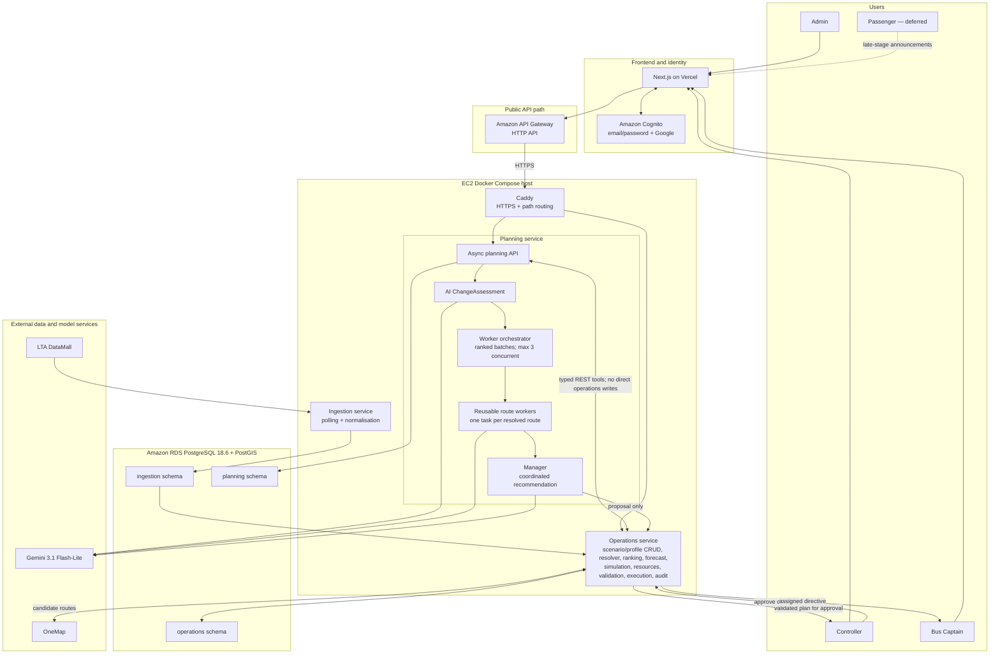

# OCC Project Vision and Delivery Plan 
## (not agreed upon and subject to more changes)

## 1. Vision

The Operations Control Centre (OCC) is a simulation-first, event-driven bus-operations decision-support system. It accepts versioned, admin-authored scenarios rather than depending on one hard-coded disruption. Each scenario may combine train incidents or disruptions, bus-stop closures, road closures, and simulated bus-bunching events.

The system uses read-only LTA DataMall data and other selected authoritative, versioned reference datasets to ground the simulation in real services, directions, stops, rail topology, and passenger-volume baselines. Enabled live DataMall feeds remain visible in an observation-only dashboard but do not trigger planning or change simulated outcomes in the MVP. Services 190 and 972 are the initial active route profiles, and the former DT1-DT10 closure is retained as one seeded example fixture rather than the application's fixed operating scenario.

Deterministic services resolve affected configured routes, calculate a no-action demand and impact baseline, rank routes and stops, simulate candidate consequences, validate resources and routes, and enforce every state change. One reusable route-worker implementation is scheduled for resolved planning-eligible routes in ranked batches, with at most three workers executing concurrently and explicit omissions when quota or deadline prevents full coverage. The manager receives the resulting proposal list and recommends a coordinated response. The LLM can interpret, advise, and propose; it cannot select affected routes, calculate demand, reserve a bus, dispatch a driver, publish an announcement, or alter operational records directly.

The project demonstrates whether a hierarchical multi-agent workflow can produce a feasible, explainable response across a configurable set of affected routes competing for limited resources during a simulated multimodal disruption.

## 2. Scope and claims

### Included

- Versioned admin-managed route profiles; Services 190 and 972 are the initial active profiles.
- Versioned admin-authored scenarios containing one or more train incidents/disruptions, bus-stop closures, road closures, or bus-bunching events.
- Configurable simulation duration from 15 minutes to four hours, in one-minute steps.
- A deterministic affected-route resolver operating only on active, validated route profiles in the MVP.
- Deterministic stop ranking by projected unmet passenger demand and waiting time.
- Read-only DataMall route, stop, and historical-demand data plus versioned authoritative rail-topology reference data.
- Live DataMall ingestion into PostgreSQL for an observation-only dashboard; live observations do not affect simulation results in the MVP.
- Replayable scenario execution for reliable demonstrations and testing.
- AI-generated, schema-valid change assessments grounded in current and previous evidence snapshots.
- Passenger-demand forecasting from versioned historical datasets, route profiles, and declared scenario parameters.
- A deterministic, time-stepped transport simulation over the resolved configured routes.
- One manager agent and one reusable route-worker implementation dynamically scheduled across resolved routes, with three concurrent worker slots and explicit coverage metadata.
- Competition for a limited standby bus-and-driver pair.
- Candidate detour calculation through OneMap.
- Detour validation against an explicitly modelled road-closure and vehicle-clearance registry.
- Turn-by-turn instructions in the simulated Bus Captain interface.
- Scenario-appropriate standby dispatch, detour, closed-stop skip, hold, dwell-time, and passenger-announcement directives.
- Controller review and execution of plans.
- A small account system with `ADMIN`, `CONTROLLER`, and `DRIVER` roles.
- A schema and mock records for depots, buses, drivers, rosters, and standby availability.
- Late-stage automatic simulated dispatch and in-app passenger announcements, governed by deterministic policy.
- An auditable record of data, forecasts, simulations, agent activity, validation, decisions, execution, and acknowledgement.

### Excluded

- Whole-network fleet tracking, optimisation, or deployment.
- Claims that the architecture has been proven at whole-network scale.
- Connections to real operator fleet systems, driver rosters, SOS systems, or in-vehicle units.
- Computer vision or automated CCTV interpretation.
- Detailed driver-rest, payroll, leave, or workforce-scheduling engines.
- Real public-announcement channels such as SMS, social media, or station systems.
- Real-world unapproved dispatch.
- Whole-network route resolution or planning over routes without an active, validated admin-managed profile.
- A separately coded agent per service; all routes use the same reusable worker implementation.
- Live DataMall observations initiating planning or altering simulation outcomes.
- Manual additions to or removals from a resolver result.
- Temporary replacement stops or bus diversions for a bus-stop closure.
- Safety certification of generated detours or operational instructions.

### Honest interpretation

Operator, fleet, driver, depot, dispatch, intervention-rule, and vehicle-restriction data are owned by the prototype and are initially mocked. DataMall supplies reference, historical, and observation-only data; it does not provide a complete operator fleet feed, stable identities for the prototype's buses and drivers, or operational authority.

The system is a simulation and decision-support prototype. Modelled passenger impact is not evidence of real-world passenger savings. A validated simulated detour is not an authorised bus route.

## 3. Users and permissions

### Admin

The admin manages accounts, depots, buses, drivers, simple roster entries, availability, versioned route profiles, rail-transfer mappings, alternative-stop mappings, and versioned scenario definitions. DataMall-imported services, directions, stop sequences, rail lines, stations, and ordered rail segments remain read-only reference data. Records used by a simulation are immutable; editing them creates a new version.

### Controller

The controller can view live and simulated bus-operations data, inspect incidents and evidence, compare route-worker proposals, see the manager recommendation, approve or reject actions, execute approved plans, and monitor driver acknowledgement.

### Bus Captain

The driver sees only directives assigned to the driver's simulated bus and route. The driver can view detour geometry and turn instructions, read operating notices, and acknowledge receipt.

### Passenger

A public passenger view is deferred until the end of the project. Its initial responsibility is limited to displaying simulated service announcements. It has no authenticated operational access.

### Authentication

Use Amazon Cognito with email/password authentication and Google federation. Cognito groups or equivalent token claims represent `ADMIN`, `CONTROLLER`, and `DRIVER` roles. The Next.js application controls navigation and session presentation, while every Spring endpoint independently validates the Cognito-issued token and required role. Hidden navigation and CORS are not access controls.

Google login requires a Google OAuth client, approved redirect URIs, and Cognito managed-login or hosted-UI configuration. These credentials and callback URLs must be configured per environment and must never enter the browser bundle as secrets.

### Basic profile management

Persist an application profile keyed by the Cognito `sub` in `operations.user_profile`. Store only the fields needed by the prototype: display name, application role linkage, optional contact or notification preference, creation time, and update time. Cognito remains the authority for credentials, verified email, federation, and account status.

An authenticated user can view and update permitted profile fields. Users cannot change their own role, Cognito subject, verified email, driver assignment, or operational permissions. Administrators may view profiles and manage application-role linkage through a protected endpoint. Profile operations must be available through the REST API, documented in OpenAPI, and represented in the authenticated frontend.

## 4. Configurable scenarios and route profiles

### Scenario definitions

An admin creates a scenario through a validated form. A scenario lasts from 15 minutes to four hours and may contain multiple simultaneous events. Supported MVP event types are:

- `TRAIN_EVENT`: affected read-only line and ordered station segment, operational effect (`DELAY`, `PARTIAL_CLOSURE`, or `FULL_CLOSURE`), direction or bidirectional state, validity window, and severity.
- `BUS_STOP_CLOSURE`: affected read-only stop code, validity window, and required configured alternative-stop mapping.
- `ROAD_CLOSURE`: road name, start and end coordinates defining a blocked segment, direction where relevant, and validity window.
- `BUS_BUNCHING`: configured service, direction, monitored stop, and explicit abnormal simulated arrival timings sufficient to exercise the deterministic two-observation rule.

Train, bus-stop, and road event forms never ask an admin to provide an affected-route list; the deterministic resolver derives it. A bus-bunching event necessarily identifies the service and direction whose explicit simulated timings will be evaluated. A scenario definition is editable only until it has been used; a later edit creates a new immutable version. Every run snapshots the exact scenario, route-profile, topology, historical dataset, formula, resource, and restriction versions needed for replay.

### Route profiles

A route profile references a read-only imported `serviceId`, `directionId`, and ordered stop sequence. Its versioned admin-managed fields include:

- operating-period headways and bus capacity;
- active simulation stops and monitored stops;
- control stops and maximum permitted hold or dwell adjustment;
- allowed intervention types and safety/accessibility exclusions;
- rail-transfer mappings containing affected station or segment, boarding stop, direction, and downstream coverage;
- alternative-stop mappings used for bus-stop closures;
- depot/resource eligibility and vehicle restrictions;
- activation state and validation outcome.

Activating a profile requires complete demand, headway, capacity, topology, mapping, and intervention configuration. Services 190 and 972 are seeded as the first active profiles. Additional imported services can be enabled later through the same protected admin REST and UI workflow without code changes.

### Seeded demonstration fixture

The former bidirectional DT1-DT10 closure from Bukit Panjang to Stevens remains a seeded, resettable example. Its verified Services 190 and 972 profiles, transfer stops, observation stops, coefficients, resource conflict, and expected outcomes are fixture data rather than code-level constants.

Each resolved route worker must return at least:

1. An option using existing capacity.
2. An option using an eligible shared standby pair when one exists.
3. Event-appropriate interventions permitted by the active route profile.
4. Forecast and simulation results produced by shared deterministic tools.
5. Evidence, assumptions, limitations, and scenario/profile version IDs.

The manager compares a list of route proposals and recommends one coordinated plan. It explains selected and rejected alternatives, resource contention, partial coverage, applied operating policy, and material uncertainty.

### Required scenario variants

- The seeded DT1-DT10 example favours Service 190, favours Service 972, and exercises a deterministic tie.
- A multi-event scenario combines at least two supported event types and deduplicates their affected routes and stops.
- A train disruption is rejected when the required historical station or OD baseline is absent or too coarse.
- A bus-stop closure proposes skipping the closed stop and announces its configured alternative; it does not invent a temporary stop.
- A road-closure segment intersects a configured route and requires a candidate detour.
- The first candidate detour violates the simulated vehicle-clearance registry.
- A bunching fixture contains explicit same-service, same-direction arrival timings; simultaneous arrivals by different services are not classified as bunching.
- No eligible standby pair exists, or a bus or driver becomes unavailable after planning.
- One worker fails or misses the 60-second planning deadline while other proposals complete.
- No worker completes, causing a visible failed planning run with no manager recommendation.
- The remaining Gemini quota covers only the highest-ranked subset of resolved routes.
- A worker or manager returns invalid output.
- DataMall observation feeds are stale or unavailable without changing the deterministic simulation.
- The same approval or acknowledgement request is submitted twice.

## 5. Data sources and ingestion

### Initial feed inventory

The initial set is:

| Source | Use | Ingestion pattern |
|---|---|---|
| Bus Arrival v3 | Observation-only ETA and categorical load for stops referenced by active route profiles | Poll configured monitored stops every minute |
| Traffic Incidents | Observation-only road-incident context | Poll every minute |
| Traffic Speed Bands v4 | Observation-only corridor-speed context | Poll every minute |
| Train Service Alerts and GTFS realtime train alerts | Observation-only rail-disruption context | Poll both every minute and normalise them into one canonical alert model |
| Station Crowd Density Real Time | Observation-only current station crowd category | Poll every minute where supported |
| Station Crowd Density Forecast | Observation-only near-term station crowd category | Poll at a suitable interval and preserve source timestamps |
| Bus Routes, Services, and Stops | Read-only reference topology used by route profiles and the resolver | Refresh at startup or through an administrative job, not every minute |
| Rail Lines, Stations, and Ordered Segments | Read-only rail topology used by scenario forms and transfer mappings | Import from the selected authoritative static dataset and version each import |
| Passenger Volume by Train Station | Historical demand baseline | Import when a new source file is published |
| Passenger Volume by Origin-Destination Train Stations | Historical movement baseline | Import when a new source file is published |
| Passenger Volume by Bus Stop / OD | Required historical baseline for configured bus-stop closures and road-closure route impact | Import when a new source file is published |

Bus Arrival v3 is stop-scoped and returns only the next approaching buses. Polling is limited to monitored stops referenced by active route profiles. It must not be described as whole-fleet tracking. In the MVP, no live observation changes scenario demand, affected-route resolution, simulation state, or planning output.

Flood Alerts are deferred and are not part of the initial ingestion workload. They may be added later as a separate observation connector without changing the simulation engine.

Preserve both train-alert source records. Deduplicate only at the canonical incident layer using the affected line and stations, disruption state, overlapping validity window, and a normalized message hash. A canonical incident records links to every contributing source observation so deduplication never destroys provenance.

### Simulation and observation separation

- `SIMULATION`: a versioned admin-authored scenario supplies every disruption, demand input, simulated arrival, vehicle state, and action.
- `OBSERVATION_ONLY`: enabled live DataMall feeds are displayed with source timestamps, freshness, and failures but cannot initiate planning or influence a simulation in the MVP.

Every incident, forecast, simulation, proposal, and UI view displays its classification. Simulated records must never be presented as live source observations, and observation records must never be attached to a simulation input snapshot in the MVP.

### Polling behaviour

The Ingestion service runs a one-minute scheduler for enabled dynamic feeds. Each connector records the source's own observation timestamp, fetch time, outcome, and freshness. A failed request does not replace valid state with empty data; the last successful observation remains available with a stale marker.

Polling must include timeouts, bounded retry with backoff, response validation, pagination where required, idempotent writes, and per-source health status. Static and monthly datasets follow their own refresh cadence instead of being downloaded every minute.

### Storage recommendation

Storing DataMall values in PostgreSQL is appropriate. Use two layers:

1. **Raw observations** preserve the received payload, source, request parameters, checksum, fetch time, source timestamp, HTTP outcome, and `OBSERVATION_ONLY` classification. This supports debugging and feed-health analysis.
2. **Normalised tables** expose typed, indexed observation data used by the dashboard and separate versioned reference/historical data used by configuration and simulation.

Do not make agents interpret arbitrary raw JSON during planning. Ingestion validates and normalises it first.

Recommended ingestion tables include:

- `ingestion.poll_run`
- `ingestion.raw_observation`
- `ingestion.feed_status`
- `ingestion.bus_arrival_observation`
- `ingestion.traffic_incident_observation`
- `ingestion.traffic_speed_observation`
- `ingestion.train_alert_observation`
- `ingestion.station_crowd_observation`
- `ingestion.station_crowd_forecast`
- `ingestion.train_station_volume`
- `ingestion.train_od_volume`
- `ingestion.bus_stop_volume`
- `ingestion.bus_stop`
- `ingestion.bus_service`
- `ingestion.bus_route_stop`
- `ingestion.rail_line`
- `ingestion.rail_station`
- `ingestion.rail_line_station`
- `ingestion.reference_dataset_version`

Each time-varying row should include `source`, `source_key` or a stable derived checksum, `observed_at`, `fetched_at`, and `ingested_at`. Store coordinates in PostGIS where spatial queries are required. Add uniqueness constraints that make repeated polls idempotent and indexes that support source/time, station/time, stop/service/time, and active-incident queries.

Keep current-state views separate from historical observations. Retain raw and normalised observations for 24 hours, then remove them through a scheduled retention job. Static reference data, imported historical passenger-volume datasets, scenario fixtures, audit records, forecasts, simulations, plans, and operational assignments are not governed by this 24-hour telemetry window and require separate retention rules.

## 6. Passenger-demand forecasting and transport simulation

### Deterministic affected-route resolver

The Operations service resolves routes before any LLM call. The MVP resolver considers only active, validated admin-managed route-profile versions; imported routes without an active profile are outside the candidate set. Route selection is deterministic and cannot be manually overridden.

For each scenario event, the resolver applies these rules:

| Event | Route and stop matching rule |
|---|---|
| Train disruption | Select active route directions whose versioned rail-transfer mappings serve an affected station or segment. Use the mapping's boarding stop and downstream coverage; geographic proximity alone is insufficient. |
| Bus-stop closure | Select active route directions containing the closed stop. Require an active alternative-stop mapping before the event can run. |
| Road closure | Intersect the blocked start/end segment with the active profile's versioned derived route geometry in PostGIS. |
| Bus bunching | Select the explicitly configured service, direction, and monitored stop after the deterministic bunching rule confirms the supplied simulated timings. |

Results from simultaneous events are combined and deduplicated by `serviceId` and `directionId`. Each included or excluded candidate records event IDs, matched stops or geometry, rule version, topology/profile version, reason, and evidence IDs. If no active route is affected, the scenario fails visibly before planning.

DataMall supplies ordered bus stops but not an authoritative driven shape for this design. On route-profile activation, the Operations service requests a OneMap road path between each consecutive stop, joins the segments, validates continuity, and stores a versioned derived geometry. A profile cannot activate if a complete geometry cannot be produced. The UI labels this geometry as derived rather than as an official operator route alignment.

### Route and stop ranking

After route resolution, the deterministic forecast and no-action simulation calculate the values needed for ranking. The resolver pipeline ranks affected routes by projected passenger-minutes of delay, then projected unmet demand, then affected-stop count. Data quality is an eligibility gate rather than a hidden score. Exact ties use `serviceId` and `directionId` for stable ordering.

Within each route, affected stops are ranked by projected unmet demand and expected passenger waiting time. Safety and accessibility flags remain hard constraints and are not converted into subjective weights. The stored result includes every intermediate value, tie-break, formula version, and excluded stop reason.

### Forecasting approach

The MVP uses a deterministic forecasting model rather than training a machine-learning model. DataMall does not provide a route-level prediction of displaced passengers for an arbitrary simulated disruption. The forecast combines:

- Versioned historical passenger volume by train station and train origin-destination for train disruptions.
- Versioned historical bus-stop or bus OD volume where required for bus-stop and road events.
- The affected segment, scenario time and duration, severity, and active route-transfer mappings.
- Route-profile headway, capacity, downstream coverage, and synthetic initial vehicle state.
- Explicit, versioned formula coefficients and an `OTHER` alternative.

Live DataMall observations are excluded from the forecast in the MVP. If the required historical baseline is absent or too coarse for the affected station, stop, direction, and time period, scenario validation fails; the simulator must not silently substitute a synthetic baseline. The forecast output contains a value or range, dataset and profile versions, coefficients, assumptions, and a data-quality state. The LLM may explain or compare the forecast but cannot generate the numeric forecast itself.

### Demand allocation model

For each affected demand cohort and simulation minute \(t\), estimate displaced demand:

\[
D_t = R_t \times C \times S
\]

Where:

- \(R_t\) is the applicable historical baseline for the affected station, stop, OD cohort, direction, and operating period.
- \(C\) is the configured event impact factor for the scenario event type and severity.
- \(S\) is the demand-scenario multiplier: low \(=0.75\), expected \(=1.00\), and high \(=1.25\).

For a train-disruption demand cohort, let \(I_t\) be the dynamic collection of planning-eligible `serviceId`/`directionId` bus alternatives with a valid transfer mapping and downstream coverage. Evaluate every member of \(I_t\) plus `OTHER`. No formula field is named after a specific service. Use an equal prior \(B_i=1\) for every eligible mapped bus alternative; wait, available capacity, and total journey time including transfer walking distinguish the alternatives. `OTHER` uses a versioned global outside-option base value \(B_{OTHER}\). All inputs and derivations are persisted.

For each alternative, calculate:

\[
A_i = \exp\left(-0.40W_i-0.35K_i-0.25T_i\right)
\]

Each penalty is capped to the range 0–1:

- \(W_i=\min(1,\text{estimated wait}/30\text{ minutes})\).
- \(K_i=\min(1,1-\text{available capacity}/\text{vehicle capacity})\).
- \(T_i=\min(1,\text{estimated journey time}/90\text{ minutes})\).

For `OTHER`, use versioned outside-option penalties:

\[
W_{OTHER}=0.50,\qquad K_{OTHER}=0.30,\qquad T_{OTHER}=0.50
\]

Calculate unnormalised preference and normalized share:

\[
U_i=B_i\times A_i
\]

\[
P_i=\frac{U_i}{\sum_{k\in I_t\cup\{OTHER\}} U_k}
\]

Allocate displaced demand:

\[
D_{i,t}=D_t\times P_i
\]

For every bus alternative \(i\in I_t\), boarding is capacity-constrained:

\[
\operatorname{boardings}_{i,t}
=\min\left(D_{i,t}+Q_{i,t},\operatorname{availableCapacity}_{i,t}\right)
\]

\[
Q_{i,t+1}
=\max\left(0,D_{i,t}+Q_{i,t}-\operatorname{boardings}_{i,t}\right)
\]

The `OTHER` allocation is recorded as demand choosing another mode, waiting outside the modelled bus queues, or declining the configured services; it is not boarded onto a simulated bus.

Other event types transform demand without inventing a new modal choice set:

- A bus-stop closure redirects the closed stop's historical demand to its configured alternative stop and records additional walking/transfer time; missing baseline or mapping rejects the run.
- A road closure retains the affected route's baseline demand and changes travel time, headway, and capacity availability through the validated original or detour geometry.
- A bunching event retains baseline demand and changes simulated arrivals, headways, queues, and waiting time.
- In a multi-event scenario, transformations apply in a fixed versioned order: base demand, train displacement, stop redirection, road travel-time effects, then bunching arrival effects. Conservation checks run after every stage.

Store \(R_t\), \(C\), \(S\), all base shares, penalties, intermediate values, historical dataset IDs, simulation-input snapshot IDs, and a formula-version identifier with every simulation result. Sensitivity tests vary each coefficient by plus and minus 10%, one at a time, and report whether the manager's resource allocation reverses.

Gemini may interpret these results but cannot create, tune, or silently change any coefficient or formula. A coefficient or formula change requires a new version and a recorded human-authored reason.

### Time-stepped simulation

The simulator advances in one-minute steps for the scenario's configured duration of 15 minutes to four hours. It models only the resolved service directions and stops needed by the versioned scenario.

Suggested state:

- Passenger arrivals and queue by stop.
- Bus location along a simplified route progression.
- Available vehicle capacity and categorical occupancy.
- Travel time between modelled stops.
- Boarding and alighting assumptions.
- Standby-bus deployment time.
- Active standby, hold, dwell, closed-stop skip, and detour directives.

Suggested outputs:

- Queue length and unmet demand over time.
- Estimated waiting time and passenger-minutes.
- Bus occupancy and unused capacity.
- Headway deviation.
- Passengers affected by a closed stop and redirected to its configured alternative.
- Incremental effect of each candidate action.

Every formula, coefficient, capacity, and simplification must be documented. Scenario coefficients are synthetic unless a cited dataset supports them.

Each simulation result records its demand variant, coefficient-set version, historical dataset and profile versions, initial state, selected interventions, and output metrics. This makes a manager decision reproducible without depending on expiring observation-only telemetry.

### Deterministic bus-bunching detection

Bus bunching is evaluated separately for each bus service, direction, visit where relevant, and monitored stop. Buses from different services are never classified as bunched merely because they arrive together.

For one valid arrival snapshot, sort the predicted arrival times for the next buses belonging to the same service and mapped direction. Planning uses the explicit simulated timings in the scenario; live Bus Arrival snapshots may run the same detector for observation-only display but cannot initiate planning:

\[
e_1 \leq e_2 \leq e_3
\]

Calculate each observable headway:

\[
h_j=e_{j+1}-e_j
\]

Let \(H_{r,d,p}\) be the expected headway for service \(r\), direction \(d\), and operating period \(p\). Read it from the active route-profile version. If the service, direction, snapshot validity, or expected headway cannot be established, return `INSUFFICIENT_EVIDENCE` rather than guessing.

The initial MVP rule is:

\[
\text{bunchingCandidate}=h_j \leq 0.50H_{r,d,p}
\]

Confirm `BUNCHING` only when the short-headway condition appears in two consecutive valid one-minute observations. A following headway of at least \(1.50H_{r,d,p}\) increases severity because it indicates a likely service gap, but it is not required to identify bunching. Store the thresholds, expected-headway source, observation IDs, calculated headways, formula version, first-seen time, last-seen time, and state with every event.

This is local detection at configured stops using the next approaching buses; it is not whole-network fleet tracking. A live observation-only result can generate a dashboard warning but cannot create a planning incident or directive. In the simulation, the following bus may receive a controller-approved hold or dwell adjustment at a designated control stop, subject to the 120-second and crowd-safety limits. The system never recommends speeding to correct bunching.

Gemini may explain a confirmed event or compare responses, but it cannot decide whether bunching occurred, change the thresholds, or identify buses from ambiguous observations.

### Forecast and simulation evaluation

Use fixed fixtures with known expected tendencies, boundary cases, and conservation checks. Examples include zero additional demand, demand greater than total capacity, no standby pair, delayed standby arrival, and a detour that increases travel time. Do not evaluate synthetic predictions as if ground-truth real disruption demand were available.

## 7. Multi-agent design

### AI change assessment

Before route workers propose actions, deterministic code compares the latest valid simulated incident and operating snapshot with the previous accepted snapshot. It packages the changed fields, scenario and configuration versions, resolver results, conflicts, and stable evidence IDs. The manager uses one schema-constrained Gemini call to interpret that package as a `ChangeAssessment` containing:

- `changeType` and a concise account of what changed.
- Previous and current state references.
- Why the change is operationally meaningful.
- Affected routes, stops, resources, processes, and user roles.
- Urgency and severity with a stated rationale.
- Supporting and conflicting evidence IDs.
- Missing or stale data.
- Assumptions, limitations, and confidence.
- Whether replanning is recommended.

The assessment is persisted in `planning.change_assessment` with the evidence snapshot, prompt/schema/model versions, timestamps, and validation result. The controller interface presents the assessment before proposed actions. Driver and passenger-facing outputs use only the relevant approved consequences rather than exposing the full operational assessment.

The LLM does not decide whether a raw value changed, fabricate missing measurements, or directly activate replanning. Deterministic code validates identifiers, timestamps, enumerations, and required evidence. Invalid output receives the normal single repair attempt. A failed or materially low-confidence assessment is shown for controller review and cannot cause automatic execution.

This is the project's required AI-driven change interpretation. Rule-based comparison identifies exactly which structured scenario or operating fields changed. The AI step is evaluated on whether it clearly explains why multiple simultaneous events and route impacts matter together, identifies affected roles and operational context, and synthesises explicit uncertainty without changing any deterministic fact. The deterministic simulator and policy baseline remain necessary controls and provide the comparison used to evaluate whether the AI step adds value.

### Triage manager

The manager receives a versioned incident context, produces the `ChangeAssessment`, and receives one validated proposal per successfully completed affected-route worker. Its input schema contains a list keyed by `serviceId` and `directionId`, not service-specific fields. After worker batching finishes or the 60-second deadline expires, it uses shared evidence and tool-produced estimates to recommend a coordinated response.

The manager decides:

- Which routes should receive scarce eligible resources.
- Which validated candidate action set best addresses the disruption.
- Which event-appropriate detour, closed-stop skip, standby, hold, or dwell action to recommend.
- The proposed passenger-announcement content.
- A concise explanation of the trade-off.

The manager cannot execute any decision.

### Route workers

One reusable, stateless worker implementation runs with a versioned route-specific context. The orchestrator admits resolved routes in deterministic rank order subject to the preflight quota calculation, records any quota omissions, creates one task per admitted route, and executes at most three tasks concurrently. Additional admitted tasks wait and run in ranked batches; this is dynamic task provisioning, not a separate deployed service or agent class per route.

Workers do not communicate directly and cannot reserve shared resources. Each worker returns structured alternatives with tool-produced impact estimates and evidence references. The manager receives only schema-valid completed proposals plus explicit coverage metadata: resolved route count, attempted routes, completed routes, failed routes, omitted-for-quota routes, deadline status, and coverage percentage.

### Agent tools

Tools are typed Spring functions or Operations-service APIs exposed to Spring AI. They are not an MCP requirement. Recommended tools include:

| Tool | Responsibility |
|---|---|
| `getIncidentContext` | Retrieve the versioned disruption and affected segment |
| `getChangeEvidence` | Retrieve the current/previous simulation diff, configuration conflicts, version validity, and evidence metadata |
| `getAffectedRoutes` | Retrieve deterministic route-resolution, ranking, matching, and exclusion evidence |
| `getRankedStops` | Retrieve stop rankings, unmet demand, waiting time, and exclusion reasons |
| `getRouteSnapshot` | Retrieve route, demand, vehicle, and freshness context |
| `getBunchingStatus` | Return deterministic, service-and-direction-specific bunching state and supporting headway evidence |
| `getEligibleBusDriverPairs` | Return currently eligible simulated resource pairs |
| `forecastDemand` | Return deterministic displaced-demand forecasts |
| `simulateAction` | Run the deterministic scenario simulation for an action set |
| `calculateCandidateDetour` | Request route geometry and steps through OneMap |
| `validateDetour` | Check blockage intersection, vehicle height, and modelled restrictions |
| `validateDirective` | Check action parameters against supported operational rules |
| `validatePlan` | Check resource, route, directive, freshness, and execution-policy constraints |

Tool results include stable evidence IDs so agent output can cite retrieved facts. Agents never receive database credentials or arbitrary SQL access.

### Model and structured output

- Use Spring AI's Google GenAI integration.
- Use `gemini-3.1-flash-lite` for route workers and the manager.
- Give each worker a complete deterministic evidence package before inference wherever possible.
- Use one structured-output call per worker rather than an open-ended tool loop.
- Set worker temperature between 0.1 and 0.2 and use minimal thinking when supported and enabled.
- Use native structured output or schema-constrained conversion into versioned Java records.
- Validate all fields after deserialisation.
- Limit available tools by agent role.
- Cap tool calls and allow at most one repair/retry after invalid output.
- Persist the invocation purpose (`CHANGE_ASSESSMENT`, `ROUTE_WORKER`, or `MANAGER_DECISION`), model name, prompt version, schema version, latency, token usage when available, tool calls, and validation result.
- Save successful, reviewed outputs as replay fixtures for frontend and integration development.

No Gemini model may alter forecasting coefficients or execute operational state changes. There is no LLM spending budget. Usage is governed by a stated provider limit of 500 requests per day and an application-side ceiling of 450 requests per provider quota day, leaving 50 requests for failures and manual testing.

Count every attempted model request, including retries, workers, manager calls, and manual tests where they pass through the application. Increment the counter atomically before sending a request. Before a planning run, reserve capacity for the manager call and determine how many ranked worker calls fit under the remaining application ceiling. Process the highest-ranked routes that fit and record the rest as `OMITTED_QUOTA`; the manager may proceed with a prominent partial-coverage warning. At the 450-request ceiling, stop automatic model calls and use manual handling; never replay a reviewed output against different evidence. Reset the application counter daily at 00:00 GMT+8.

Persist the quota counter and replay fixtures in Planning-owned tables such as `planning.model_request_usage` and `planning.replay_fixture`. A replay fixture records its originating prompt, schema and model versions, input evidence snapshot, reviewed output, and approval status. Never replay an output against different operational evidence as though it were a fresh decision.

### Failure behaviour

- A planning run has a 60-second deadline covering all ranked worker batches.
- If quota preflight cannot admit at least one worker and preserve one manager call, the run fails visibly before worker execution.
- A failed or timed-out worker produces a visible route-level failure; it does not silently fabricate a proposal.
- If at least one worker succeeds, the manager may proceed using completed proposals only, with a prominent partial-coverage warning listing failed, timed-out, and quota-omitted routes.
- If no worker returns a valid proposal within 60 seconds, the run fails visibly and no manager recommendation is requested or produced.
- Invalid structured output receives one repair attempt and then fails safely.
- A late result from a superseded job is recorded but cannot become active.
- Stale or contradictory evidence is identified in the proposal.
- A failed or low-confidence change assessment remains visible to the controller and cannot initiate automatic execution.
- A failed validation returns the explicit reason. It never silently changes the manager's chosen allocation.

## 8. Routing and operational directives

### Detour calculation

OneMap supplies a candidate driving route, geometry, distance, duration, and turn instructions. A road-closure event supplies a blocked start/end segment and, where needed, validated profile waypoints that steer the route around the blockage.

### Clearance validation

The prototype maintains a curated restriction registry for configured route-profile corridors, including:

- Restricted road segment geometry.
- Maximum modelled vehicle height.
- Active closure status and validity period.
- Direction where relevant.
- Source classification: simulated scenario or operator-maintained. Observation-only live incidents cannot become simulation restrictions in the MVP.

A detour is valid only if it avoids the configured blockage, respects the simulated vehicle-height restriction, connects the required points, and has complete route instructions. Wider legal route approval, axle weight, turning envelope, temporary orders, and comprehensive real-world restriction coverage are outside scope.

### Supported directives

- Hold or adjust dwell for no more than 120 seconds per affected bus and only at a designated control stop. Do not hold at an active boarding stop when doing so would worsen an unsafe crowd condition.
- Maintain headway while obeying legal and operational limits.
- For a configured bus-stop closure, skip only the closed stop and direct passengers to its active alternative-stop mapping. The MVP does not create a temporary stop or bus diversion for this event.
- Follow a validated simulated detour.
- Allocate and dispatch a standby bus-and-driver pair.
- Publish a simulated passenger announcement describing the approved consequence and configured alternative where applicable.

The system must never issue an instruction to exceed a speed limit. “Speed adjustment” is represented through holding, dwell-time adjustment, or a direction to maintain the planned headway within legal limits.

A bunching response may hold or adjust the dwell of the following simulated bus only when the bunching detector has confirmed the event, the bus is unambiguously mapped to a prototype assignment, and the stop is an approved control point. Cross-service proximity, a single noisy observation, or ambiguous direction data cannot generate a bunching directive.

Each directive includes incident, plan and version IDs, target route and vehicle, affected stops or geometry, parameters, reason, issue and expiry times, approval/execution mode, and acknowledgement state. Every directive expires after 15 minutes unless a new validation and renewal extends it.

### Event-to-intervention policy

The supported actions are determined by event type and the active route-profile version, never by service-specific code:

| Event | Permitted MVP proposals |
|---|---|
| Train disruption | Standby deployment; limited extra dwell at an affected mapped transfer stop when simulation shows normal dwell is insufficient; passenger announcement. Holding is not permitted unless a separate confirmed bunching event exists. |
| Road closure | Validated detour; standby deployment when capacity or headway materially deteriorates; passenger announcement. |
| Bus-stop closure | Skip the closed stop; direct passengers to the configured nearby alternative; passenger announcement. |
| Bus bunching | Hold or dwell adjustment for the following mapped simulated bus at an approved control stop. |

A multi-event scenario may combine actions only after every applicable type-specific validator passes. Stops marked safety- or accessibility-critical cannot receive an incompatible action. The seeded DT1-DT10 fixture stores any protected stops and permitted control stops in its profile data; those stop codes are not global application policy.

### Hard validation

Deterministic validation checks event/action compatibility, resource availability, vehicle compatibility, driver availability, valid stops and route direction, active alternative-stop mappings, route clearance, the 120-second hold/dwell limit, designated control-stop status, safety/accessibility exclusions, the 15-minute directive lifetime, version freshness, conflicting active directives, and whether the execution policy permits automatic action.

## 9. Decision, execution, and automation

### Manual path

```text
Scenario run -> immutable snapshot -> affected-route resolver
    -> no-action forecast/simulation -> route/stop ranking
    -> ranked worker batches (maximum three concurrent) -> manager recommendation
    -> deterministic validation -> temporary resource reservation
    -> controller review -> revalidation -> execute or reject
    -> driver notice -> acknowledgement -> audit
```

### Late-stage automatic path

Automatic action is deferred until the manual workflow, validation, and audit trail are stable.

The manager still only recommends a plan. The Operations service evaluates a deterministic execution policy. When the plan qualifies, the Operations service may automatically:

- Reserve and assign a simulated standby bus-and-driver pair.
- Publish a simulated passenger announcement to the deferred passenger view.

Detours, closed-stop skips, holds, and dwell directives require controller approval under the current decision. Expanding automatic execution to those actions requires a new explicit decision and policy change.

An automatically dispatched plan must be visibly labelled, use the same validators and idempotency rules as a manual plan, and be reversible within the simulation where operationally possible.

### Concurrency and consistency

- Workers and LLM calls operate on versioned snapshots without holding database locks.
- The Operations service is the only resource-allocation authority.
- Resource pairs are reserved atomically in a short database transaction.
- Database constraints prevent conflicting active assignments.
- Reservations last five minutes and expose a countdown derived from the server expiry time.
- Reservations are released on controller rejection, plan replacement, or expiry.
- Execution revalidates state even after an earlier validation.
- Bus and driver availability are revalidated immediately before execution even when the reservation has not expired.
- Approval, automatic execution, and acknowledgement use idempotency keys.
- A changed bus, driver, road restriction, or relevant source snapshot marks the plan stale.

## 10. Operator-management model

Fleet and workforce CRUD screens and workflows are deliberately deferred until Week 6 so the assessable change-to-action pipeline is completed first. Route-profile, mapping, and scenario-definition CRUD cannot be deferred because the configurable resolver and simulator depend on them; their protected REST and UI vertical slice is delivered by Week 2. All schemas, REST contracts, and seeded records are created early.

Recommended entities:

- `operations.depot`
- `operations.vehicle`
- `operations.vehicle_type`
- `operations.driver`
- `operations.roster_entry`
- `operations.driver_availability`
- `operations.vehicle_availability`
- `operations.standby_pair`
- `operations.resource_reservation`
- `operations.assignment`
- `operations.directive`
- `operations.directive_acknowledgement`
- `operations.bunching_event`
- `operations.route_profile`
- `operations.route_profile_version`
- `operations.route_control_stop`
- `operations.route_intervention_rule`
- `operations.rail_transfer_mapping`
- `operations.alternative_stop_mapping`
- `operations.derived_route_geometry`
- `operations.scenario_definition`
- `operations.scenario_version`
- `operations.scenario_event`
- `operations.scenario_run`
- `operations.affected_route_resolution`
- `operations.affected_route_candidate`
- `operations.stop_impact_ranking`

A dispatch allocates a compatible bus-and-driver pair. The MVP roster only records a driver's scheduled window, depot, role/status, and availability. It does not calculate legal rest compliance or generate schedules.

Protected route-profile CRUD includes create, read, update-by-new-version, activate, deactivate, and validation for operational profile data, rail-transfer mappings, alternative-stop mappings, and intervention rules. Imported service, direction, stop, and rail topology is read-only. Protected scenario CRUD includes create, read, update-by-new-version, deactivate, validate, and start-run operations. Records referenced by a run are immutable and cannot be destructively deleted.

The deferred fleet CRUD scope is limited to create, read, update, and deactivate operations for depots, vehicles, drivers, roster entries, and vehicle/driver availability. Hard deletion is not required for records referenced by audits, simulations, assignments, or directives; those records use inactive status instead. Standby pairs and assignments are managed through their operational workflows rather than unrestricted generic CRUD.

## 11. Architecture

### Services

| Component | Ownership |
|---|---|
| Ingestion service | DataMall clients, polling, raw observations, normalisation, feed health and freshness |
| Operations service | Identity and profile integration, scenario/profile configuration, affected-route resolution, route/stop ranking, forecasting, simulation, bus-bunching detection, routing validation, resources, reservations, directives, execution, announcements, audit |
| Planning service | Spring AI change assessment, dynamic worker orchestration, manager, agent tools/adapters, model runs, proposals, coverage status and explanations |
| Next.js frontend | Controller, admin and driver interfaces; deferred passenger view |

The resolver, ranking engine, routing adapter, forecast engine, simulator, and automation policy remain modules of the Operations service. Creating separate microservices for each would add deployment and consistency overhead without helping the configurable-route goal.

### Current architecture diagram



The Operations service resolves and ranks affected active route profiles before `ChangeAssessment` and worker orchestration. The Planning service never asks Gemini to decide which routes or stops are affected.

### Service interaction

```text
DataMall -> Ingestion service -> PostgreSQL ingestion schema
                                  |
                                  v
                           Operations service
                 scenario/profile CRUD + resolver + simulation
                           /        |        \
                    OneMap     Planning API   Next.js users
                                   |
                    ranked worker batches + manager
                                   |
                          read-only typed tools

Operations service -> reservations/directives/announcements -> PostgreSQL
```

Use synchronous REST for bounded reads and commands. Planning is asynchronous: the API returns a job ID and the UI polls persisted status. No request should wait for the full multi-agent workflow at API Gateway.

Every externally consumed REST endpoint must have a versioned OpenAPI contract generated from or validated against the Spring implementation. A deployed Swagger UI or equivalent OpenAPI viewer must document authentication, roles, request and response schemas, validation errors, idempotency requirements, and representative examples. OpenAPI generation and contract validation run in CI so documentation cannot silently drift from the implementation.

### Database ownership

Use one Single-AZ Amazon RDS for PostgreSQL 18.6 `db.t4g.micro` instance with 50 GiB of gp3 storage and PostGIS enabled. Use separate schemas and credentials:

- `ingestion`: owned by the Ingestion service.
- `operations`: owned by the Operations service.
- `planning`: owned by the Planning service.

The Planning service must use Operations APIs for operational facts and cannot write Operations tables. Cross-schema reporting views may be read-only. Use Flyway migrations owned by each service. Production configuration must disable automatic ORM schema mutation.

RDS hosting, PostGIS availability, backup configuration, and connectivity must be proven early. Enable seven-day automated-backup retention. Single-AZ is accepted for this project and provides no Multi-AZ failover claim. If the team cannot provision RDS within the budget, the documented fallback is PostgreSQL/PostGIS in Docker Compose with EBS-backed storage and tested backup/restore; switching to that fallback is an explicit infrastructure decision.

### Deployment topology

```text
Users -> Vercel Next.js
              |
       Amazon API Gateway HTTP API
              |
       Public HTTPS API origin on EC2
       - Caddy API entry point and TLS termination
       - Docker Compose private network
       - ingestion-service
       - operations-service
       - planning-service
              |
       RDS PostgreSQL/PostGIS

EC2 services -> DataMall / OneMap / Gemini APIs
ECR -> immutable backend container images
GitHub Actions -> test, build, push and controlled deployment
```

The Application Load Balancer and VPC Link are removed from this MVP. API Gateway uses a public HTTPS integration to Caddy running as the single EC2-hosted API entry point. Caddy terminates TLS and routes configured API paths to the appropriate Spring service over the private Docker Compose network. Only Caddy publishes ports `80` and `443`; application containers must not publish independent public ports. Port `80` exists only for certificate issuance or redirect to HTTPS. The backend still validates Cognito tokens and roles on every protected request.

Caddy automatic HTTPS requires a team-controlled public DNS hostname resolving to the EC2 origin and inbound access needed for certificate issuance. The hostname, DNS record, Caddy configuration, persistent certificate-data volume, and certificate-renewal behaviour must be configured and tested before cloud deployment. If the team cannot provide a suitable hostname, the API Gateway-to-EC2 HTTPS design must be revisited rather than disabling TLS.

Removing the private integration means the EC2 origin is internet-reachable, which is a documented security and availability trade-off. The team must restrict inbound ports, keep services unexposed, apply request limits, monitor direct-origin traffic, and avoid presenting API Gateway as a network isolation boundary.

One EC2 host is an accepted project constraint and a single point of failure. The prototype makes no high-availability claim. The account is a personal AWS account, and all regional project infrastructure is deployed in `us-east-1` unless an AWS global service requires otherwise.

### Budget controls

The AWS infrastructure budget is USD 100 total for the project. Create a one-time custom AWS Cost Budget from 18 September 2026 00:00 UTC through an exclusive end timestamp of 31 October 2026 00:00 UTC, which includes the final project day. Configure email notifications at:

- 50% actual spend.
- 80% actual spend.
- 100% actual spend.
- 100% forecasted spend.

Enable Cost Anomaly Detection and review Cost Explorer by service at least twice per week. Tag resources with the project and environment so costs can be attributed. Configure the alert-recipient email manually in AWS and do not record it in the repository.

An AWS Budget is monitoring and notification, not a guaranteed spending cap, and budget evaluation may be delayed. Do not configure destructive automatic shutdown for the demonstration without a separate decision. The team must estimate EC2, RDS, gp3 storage, API Gateway, EC2 public networking, ECR, Secrets Manager, logging, and data-transfer costs before provisioning. Avoid a NAT Gateway unless the topology and budget explicitly justify its fixed and data-processing costs.

### Secrets

Store the Gemini API key, DataMall key, OneMap token, database credentials, and signing secrets in AWS Secrets Manager for the deployed environment. Grant each service access only to the secrets it requires. Inject secrets at runtime; never bake them into images, commit them, log them, return them through APIs, or expose them through Next.js client-side environment variables.

Local development may use an uncommitted environment file containing developer-specific credentials. Commit only a redacted example file.

## 12. Frontend experience

### Shared account and profile experience

- Register or sign in through Cognito using email/password or Google.
- View the authenticated identity, application role, and basic profile.
- Update permitted profile fields without being able to change roles or operational assignments.
- Receive a clear forbidden response when attempting an action outside the authenticated role.

### Controller interface

- Clearly separated simulation and observation-only DataMall panels with feed-freshness indicators.
- Active scenario events, deterministic affected-route results, inclusion/exclusion reasons, and profile/topology versions.
- Ranked affected stops with projected unmet demand and waiting time.
- Service-and-direction-specific bunching warnings with observed and expected headways, severity, freshness, and supporting stop observations.
- Structured change assessment with evidence, affected entities, confidence, assumptions, conflicts, and missing data.
- Forecast demand and simulation comparison.
- Generic worker alternatives labelled by `serviceId` and `directionId`.
- Manager recommendation, evidence references, coverage percentage, and partial-coverage warning where applicable.
- Candidate detour map, clearance result, and turn instructions.
- Manual approval/rejection and execution status.
- Automatic-execution label where applicable.
- Driver acknowledgement and audit timeline.

### Driver interface

- Authenticated driver's assigned bus and route.
- Role-specific summary of how the approved change affects the assigned trip, without exposing unrelated operational data.
- Current active directive and expiry.
- Hold/dwell, closed-stop skip, standby, or detour instructions.
- Detour map and ordered turn instructions.
- Acknowledgement control and timestamp.
- Operator notices relevant to that assignment.

### Admin interface

By Week 2, provide protected REST and UI CRUD for versioned route profiles, rail-transfer mappings, alternative-stop mappings, intervention rules, and multi-event scenario definitions. Imported bus and rail topology is browsable but read-only. Profile activation displays validation failures, and editing used configuration creates a new version.

Week 6 completes CRUD for depots, vehicles, drivers, roster entries, and availability. Before this exists, seeded mock records populate the same schema. The project is not baseline-complete until both configuration and operator-domain CRUD work through protected REST endpoints and the admin interface.

### Passenger interface

Deferred until the end. Displays simulated service announcements only and never exposes operational evidence or controls.

## 13. Technology decisions

| Area | Decision |
|---|---|
| Backend language | Java 25 |
| Backend framework | Spring Boot 4.1.1 |
| AI integration | Spring AI 2.0.x Google GenAI client |
| Agent model | Gemini 3.1 Flash-Lite for workers and manager |
| Model quota guardrail | Provider limit 500 requests/day; application ceiling 450 requests/provider quota day |
| Build | Gradle 9.7.1 through committed Wrapper |
| Data store | PostgreSQL 18.6 with PostGIS |
| Managed database | Amazon RDS PostgreSQL 18.6, Single-AZ `db.t4g.micro`, 50 GiB gp3 |
| Frontend | Next.js with authenticated roles |
| Containers | Docker and Docker Compose |
| API documentation | Versioned OpenAPI contract and deployed Swagger UI or equivalent viewer |
| Backend hosting | API Gateway public HTTP API to Caddy as the public HTTPS entry point on an EC2 Docker Compose host; no ALB or VPC Link |
| TLS and reverse proxy | Caddy with a team-controlled public DNS hostname and persistent certificate storage |
| Frontend hosting | Vercel |
| Images | Amazon ECR |
| Routing | OneMap candidate routing plus curated simulated restriction validation |
| Schema migrations | Flyway |

Recommended supporting libraries include Spring Web MVC, Spring Security, Spring Data JPA or JDBC as appropriate, Actuator, Micrometer, Testcontainers, and a supported PostGIS integration. Exact library versions beyond the selected platform versions should be pinned during bootstrap and recorded by dependency lockfiles or version catalogs.

## 14. Six-week delivery plan

The project has six weeks remaining from 18 September 2026. The submission deadline is **23:59 GMT+8 on Friday, 30 October 2026**. The five-person team has up to **six project hours per person per day**, giving a stated maximum capacity of 30 person-hours per day. This is an availability ceiling, not a commitment to schedule every person at full capacity every day.

The configurable-route change is treated as core architecture from Week 1 rather than as a late refactor. Its estimated incremental effort is approximately 18-26 person-days across configuration/versioning, resolution, generalized demand, orchestration, UI, and tests. Six-week feasibility depends on preserving the stated boundaries: only active admin-managed profiles are resolved, only four event families are supported, live feeds remain observation-only, derived rather than certified route geometry is used, three workers run concurrently, and no whole-network optimisation is attempted.

### Delivery policy and course-process evidence

Use six one-week sprints tracked in Jira. By the end of Week 1, assign a Product Owner and Scrum Master, create the initial backlog, and split work into demonstrable user stories with acceptance criteria. Every code contribution goes through a GitHub pull request linked to a Jira item and reviewed by at least one teammate. CI must run relevant tests and OpenAPI contract checks before merge. Sprint reviews demonstrate working software; retrospectives record concrete process changes.

A feature is complete only when it is integrated, tested, deployed where applicable, documented in OpenAPI, and supported by evidence for its acceptance criteria. Infrastructure sophistication is not a substitute for the core change-to-action workflow.

### Week 1: assessable foundations

- Import and version read-only bus and rail topology; verify the seeded 190, 972, and DT1-DT10 fixture data against it.
- Bootstrap the three Spring Boot services, Next.js application, migrations, local Compose, and CI.
- Freeze generic `serviceId`/`directionId` REST contracts, list-based structured AI schemas, scenario/profile schemas, action schemas, OpenAPI generation, and database ownership.
- Implement Cognito email/password and Google sign-in, server-side roles, `operations.user_profile`, and basic profile view/update.
- Seed versioned route profiles for 190 and 972, transfer and alternative-stop mappings, the DT1-DT10 example, depots, vehicles, drivers, rosters, availability, and one standby pair.
- Configure the public DNS hostname, deploy Caddy with persistent certificate storage, and prove API Gateway-to-Caddy HTTPS routing to the Spring services without an ALB or VPC Link.
- Deploy the remaining minimum stack through Vercel, ECR, RDS/PostGIS, and Secrets Manager.
- Prove one scenario fixture, one reference-data import, one observation-only DataMall connector, and one schema-constrained Gemini call with persisted evidence.
- Create the Jira backlog, assign agile roles, and enforce the pull-request workflow.

**Exit condition:** an authenticated deployed user can manage a basic profile, inspect generic OpenAPI contracts, and trigger a persisted stub simulation run through the public backend.

### Week 2: AI change-to-impact slice

- Implement protected admin REST and UI CRUD for versioned route profiles, rail-transfer mappings, alternative-stop mappings, intervention rules, and multi-event scenario definitions.
- Keep imported bus and rail topology read-only; implement activation validation and immutable versioning after use.
- Implement simulation/observation-only separation, current-versus-previous simulation snapshots, and named fixture replay.
- Implement the deterministic affected-route resolver, multi-event deduplication, route ranking, and stop ranking.
- Implement and persist the structured Gemini `ChangeAssessment`, including affected entities, confidence, assumptions, conflicts, missing data, and evidence references.
- Implement generalized demand alternatives over a dynamic route collection plus `OTHER`; reject missing or too-coarse historical baselines.
- Show the change assessment and route-specific impact to the controller.
- Add safe failure for invalid scenarios, inactive profiles, incomplete derived geometry, missing baselines, contradictory evidence, and low-confidence assessments.

**Exit condition:** an admin can configure and run a non-hard-coded scenario that deterministically resolves active routes and ranks affected stops before AI interpretation, with evidence and limitations visible to a controller.

### Week 3: actionable multi-agent response

- Complete the one-minute, configurable 15-minute-to-four-hour simulation and low/expected/high demand variants.
- Implement deterministic bus-bunching detection for each supported service and direction at configured stops, including persisted events and replay fixtures.
- Implement the reusable route-worker tools and generic structured alternatives keyed by `serviceId` and `directionId`.
- Implement ranked dynamic worker tasks with three concurrent slots, batched overflow, a 60-second deadline, quota-aware highest-ranked coverage, schema validation, one repair attempt, and replay fixtures.
- Feed the manager a proposal list plus coverage metadata; proceed with a prominent partial-coverage warning when at least one route succeeds, and fail visibly without a manager call when none succeeds.
- Implement the incident, plan, reservation, directive, acknowledgement, and audit lifecycle.
- Implement atomic standby-pair reservation, five-minute expiry, revalidation, staleness, and idempotency.
- Deliver manager recommendation through controller approval to the assigned driver's acknowledgement.

**Exit condition:** the deployed system produces an actionable, explainable multi-route plan over the resolver result, prevents double assignment, exposes partial coverage, supports human approval or rejection, and records the result.

### Week 4: trust, evaluation, and operational resilience

- Add remaining required DataMall connectors and historical/crowd imports without destabilising the completed vertical slice.
- Add role-specific impact summaries for controller and driver.
- Compare Gemini change interpretation and manager decisions with deterministic baselines and recorded fixtures.
- Test confidence display, evidence traceability, missing historical baselines, invalid/inactive profiles, multi-event deduplication, invalid model output, the 60-second deadline, partial coverage, quota omission, high demand, duplicate commands, and unavailable resources.
- Test true same-service bunching, different-service simultaneous arrivals, ambiguous direction, stale arrivals, threshold boundaries, persistence across polls, and event clearing.
- Measure model latency, request usage, schema validity, policy adherence, forecast/simulation runtime, and end-to-end response time.
- Rehearse backup/restore, deployment rollback, scenario reset, and dependency-failure behaviour.

**Exit condition:** the core lecturer requirements have repeatable acceptance evidence, and failures degrade to visible human-controlled states.

### Week 5: routing and operational directives

- Implement OneMap candidate routing, configured blocked-segment avoidance, and turn instructions.
- Generate, validate, cache, and version derived route geometry from consecutive-stop OneMap paths for active profiles.
- Add the curated vehicle-height and road-restriction registry.
- Implement the event-to-intervention policy: train standby/extra dwell, road detour/standby, closed-stop skip/alternative announcement, and bunching hold/dwell.
- Complete the driver map and directive experience.
- Add road-block and clearance-failure scenarios.

**Exit condition:** a controller can approve an event-appropriate validated action set and the correct driver can view and acknowledge it; missing profile configuration cannot silently enable an action.

### Week 6: deferred baseline CRUD, optional extras, and hardening

- Complete protected REST and admin-interface CRUD for depots, vehicles, drivers, roster entries, and availability. Route/scenario configuration CRUD is already operational from Week 2.
- Verify registration, basic profile management, role enforcement, CRUD, OpenAPI, persistent AI output, and public deployment as a single baseline checklist.
- Add deterministic auto-execution for simulated standby dispatch only if the manual workflow and baseline checklist remain healthy.
- Add the passenger announcement view only if the baseline checklist remains healthy.
- Run final scenario-versioning, resolver, ranking, dynamic-demand, three-worker concurrency, partial-coverage, access-control, API-contract, and regression suites.
- Freeze features, rehearse the demo and Q&A, document measurements and limitations, and prepare reset controls.

**Exit condition:** the deployed demonstration is rubric-complete, replayable, auditable, recoverable, and supported by Jira, pull-request, test, API, and evaluation evidence.

### Suggested ownership for five people

| Person | Primary ownership |
|---|---|
| 1 | Ingestion service and DataMall data model |
| 2 | Operations domain, forecasting, simulation and concurrency |
| 3 | Planning service, Spring AI and agent evaluation |
| 4 | Next.js controller, driver, admin and deferred passenger UI |
| 5 | AWS infrastructure, CI/CD, OpenAPI governance, routing integration and end-to-end reliability |

Ownership does not mean isolation. API contracts are reviewed together, and all components integrate at least daily.

## 15. Acceptance criteria

### Accounts, profiles, API, and course process

- A user can register or sign in through the configured Cognito email/password or Google path.
- An authenticated user can view and update permitted profile fields, and the profile persists against the Cognito subject.
- A user cannot alter the user's own role, subject, verified identity fields, driver assignment, or permissions.
- Protected endpoints enforce `ADMIN`, `CONTROLLER`, and `DRIVER` roles server-side.
- Every externally consumed REST endpoint appears in the versioned OpenAPI contract with authentication, schemas, errors, and examples.
- CI detects an implementation/contract mismatch.
- The deployed backend is publicly reachable through API Gateway and the Caddy HTTPS origin without an ALB or VPC Link.
- Caddy routes only configured API paths, redirects plaintext requests to HTTPS, renews its certificate using persistent storage, and leaves Spring service ports inaccessible from the public internet.
- Jira stories, sprint evidence, linked GitHub pull requests, peer reviews, and passing CI demonstrate the required development process.

### Data and scenario

- Enabled dynamic feeds poll every minute and expose freshness and failures.
- Both train-alert feeds retain source provenance and converge on deduplicated canonical incidents.
- Repeated source observations are idempotent.
- Raw and normalised records can be traced to the same poll.
- Telemetry older than 24 hours is removed by the retention job without deleting retained simulation snapshots, audit records, or imported historical datasets.
- Live DataMall records are visibly observation-only and cannot trigger planning or change a simulation result.
- Imported bus and rail topology is versioned, browsable, and read-only through the application.
- An admin can create a 15-minute-to-four-hour scenario containing one or more supported events; only a bunching event directly identifies its subject service and direction.
- A used scenario or route-profile edit creates a new immutable version; an old run remains exactly reproducible.
- The seeded DT1-DT10 example can be reset and replayed, but no service, stop, station segment, or intervention rule from it is a code constant.
- Train incidents, bus-stop closures, road closures, and bus-bunching events each have schema and boundary fixtures; a multi-event fixture proves combination and deduplication.

### Configuration and affected-route resolution

- Protected admin REST and UI CRUD covers versioned route profiles, rail-transfer mappings, alternative-stop mappings, intervention rules, and scenario definitions.
- A route profile cannot activate without valid imported topology, headway, capacity, demand inputs, required mappings, intervention rules, and complete derived route geometry.
- The resolver considers only active, validated profiles and runs before any LLM call.
- Train events resolve through configured rail-transfer mappings; bus-stop closures through route membership; road closures through PostGIS intersection with versioned derived geometry; bunching through the explicit configured service, direction, stop, and deterministic confirmation rule.
- Multi-event results are deduplicated by `serviceId` and `directionId`, and every included or excluded candidate has a deterministic reason and evidence IDs.
- An admin or model cannot manually add or remove a resolver result.
- Routes rank by passenger-minutes of delay, unmet demand, affected-stop count, then stable identifiers; stops rank by unmet demand and waiting time.
- No affected active route causes a visible pre-planning failure.

### Forecast and simulation

- Forecasts cite their historical datasets, scenario/profile versions, coefficients, and data-quality state.
- Missing or too-coarse required historical demand rejects the scenario; no synthetic baseline is silently substituted.
- The same deterministic inputs produce the same forecast and simulation outputs.
- For every minute, the normalized alternative shares sum to one within the configured numeric tolerance.
- Bus boardings never exceed available capacity, and queued demand is carried into the following minute.
- The OTHER share is recorded separately and never appears as a simulated bus boarding.
- Every successfully processed affected route receives an existing-capacity comparison and a resource-assisted comparison when an eligible resource exists.
- Formulae and schemas operate on dynamic `serviceId`/`directionId` collections and contain no 190- or 972-specific fields.
- Boundary fixtures handle zero demand, unmet demand, stale input, and unavailable resources.

### Bus bunching

- Bunching is calculated only between consecutive buses of the same service and mapped direction at the same monitored stop.
- Buses from different services arriving close together are never classified as bunched with one another.
- The expected headway, `0.50` candidate threshold, `1.50` service-gap severity threshold, two-observation confirmation rule, formula version, and evidence IDs are persisted.
- Missing, stale, or directionally ambiguous observations return `INSUFFICIENT_EVIDENCE` and cannot trigger a directive.
- A confirmed simulated bunching event may propose holding or adjusting dwell only for the following mapped bus at a designated control stop, subject to the 120-second and crowd-safety rules.
- Gemini cannot classify bunching or change its deterministic thresholds.

### Agents

- The manager produces a schema-valid `ChangeAssessment` from a versioned current/previous evidence package before route planning.
- Every change assessment states what changed, why it matters, affected entities and roles, confidence, assumptions, limitations, missing or stale data, conflicts, and evidence IDs.
- A change assessment cannot mutate operational state, and invalid or materially low-confidence output cannot trigger automatic execution.
- One reusable worker uses real tools and returns schema-valid alternatives for each attempted resolved route.
- At most three workers execute concurrently; additional routes run in deterministic ranked batches.
- The worker phase has a 60-second planning deadline.
- If at least one worker succeeds, the manager may proceed only with completed proposals and must expose a prominent partial-coverage warning and route-level coverage details.
- If no worker succeeds within 60 seconds, the run fails visibly and no manager recommendation is produced.
- When quota is insufficient, the highest-ranked routes that fit are processed and omitted routes are named in the partial-coverage warning.
- If quota cannot admit one worker while preserving the manager call, the run fails before worker execution.
- The manager accepts a proposal list and coverage metadata and selects and explains one coordinated plan without service-specific schema fields.
- The manager cannot execute database mutations or operational actions.
- Invalid output receives at most one repair attempt before visible failure.
- Every model run records its model, prompt/schema version, latency, tool activity, and validation outcome.
- The application atomically blocks automatic model requests at 450 requests within the provider quota day.
- Reviewed successful agent outputs can be replayed without consuming live model requests.

### Resources and execution

- One bus or driver cannot appear in conflicting active assignments.
- Every reservation expires five minutes after creation and displays a server-derived countdown.
- Rejection, plan replacement, and expiry release the reservation.
- Execution revalidates the reserved bus and driver immediately before assignment.
- Plans are invalidated when relevant resource or routing state changes.
- Repeated approval, automatic execution, and acknowledgement requests are idempotent.
- A rejected or expired plan cannot dispatch a resource.
- Automatic simulated dispatch occurs only when the deterministic policy permits it.

### Routing and directives

- A blocked-road fixture produces a candidate detour with geometry and turn instructions.
- A clearance violation rejects the candidate with an explicit reason.
- Every supported directive passes type-specific deterministic validation.
- Hold/dwell changes never exceed 120 seconds and respect control-stop and crowd-safety rules.
- A train-disruption hold is rejected unless a separate confirmed bunching event exists; limited extra dwell requires simulated boarding need at a mapped transfer stop.
- A bus-stop closure can skip only the closed stop and requires an active alternative-stop mapping and passenger announcement.
- A road closure uses start/end segment intersection and only a clearance-valid detour.
- A bunching hold or dwell change targets only the following mapped simulated bus at an approved control stop.
- Every directive expires after 15 minutes unless revalidated and renewed.
- No directive instructs a driver to exceed a legal speed.
- Only the assigned driver can view and acknowledge a protected directive.

### Access and secrets

- Admin, controller and driver endpoints enforce server-side roles.
- Passenger access, when implemented, cannot invoke operational commands.
- API keys and database credentials are absent from repositories, images, browser bundles, API responses, and logs.

### Domain and configuration CRUD

- An admin can create, read, update, and deactivate depots, vehicles, drivers, roster entries, and availability records through protected REST endpoints and the admin interface.
- An admin can create, read, version, validate, activate, and deactivate route profiles, rail-transfer mappings, alternative-stop mappings, intervention rules, and scenario definitions through protected REST endpoints and the admin interface.
- Imported bus and rail reference topology cannot be edited through admin CRUD.
- Records referenced by audit or operational history cannot be destructively deleted.
- CRUD changes are validated, persisted, audited where operationally relevant, and reflected in subsequent resource-eligibility checks.

## 16. Evaluation

Run each named scenario repeatedly with recorded model, prompt, formula, topology, scenario, and route-profile versions. Compare the manager's recommendation against a deterministic policy baseline that enumerates feasible allocations across the resolved routes.

Measure:

- Feed success, staleness, and ingestion delay.
- Change-assessment schema validity, evidence grounding, confidence calibration, and agreement or disagreement with reviewed fixtures.
- Forecast and simulation runtime.
- Resolver precision on labelled train, stop, road, bunching, and multi-event fixtures; route/stop rank stability; geometry-generation failures.
- Bunching-detection precision on labelled fixtures, confirmation delay, false positives from different services, and stale-data rejection.
- Agent planning latency, tool-call count, invalid-output rate, and repair rate.
- Worker batch count, three-slot concurrency, deadline completion, proposal coverage percentage, partial-coverage frequency, and quota-based omissions.
- Gemini 3.1 Flash-Lite manager latency, request consumption, policy adherence, structured-output validity, and allocation consistency.
- Conflicting requests detected and invalid assignments prevented.
- Plan staleness, expiry, and duplicate-execution prevention.
- Candidate detour success and validation failures.
- End-to-end time from event to recommendation, execution, and acknowledgement.

Report estimated passenger impact only under the documented simulation model. Do not report it as measured operational improvement.

## 17. Extensibility boundary

The MVP resolver considers only active, validated admin-managed route profiles. Its contracts and imported topology model preserve enough information to consider all imported routes later, but an unconfigured route is not silently assigned default capacity, demand, control stops, mappings, or intervention permissions. Extending discovery to all imported routes requires an explicit eligibility state such as `UNCONFIGURED_REFERENCE` and a reviewed onboarding workflow; it is not part of this six-week scope.

## 18. Project outcome

The completed project should demonstrate an admin-defined multi-event scenario moving through immutable snapshotting, deterministic affected-route resolution, no-action demand and impact forecasting, route and stop ranking, configurable-route candidate simulation, ranked worker batching, manager coordination, deterministic validation, resource allocation, controller or policy execution, driver notification, and audit. DataMall live feeds remain a clearly separated observation-only capability.

Success is a reliable and explainable configurable-route simulation prototype under resource contention, demonstrated initially with Services 190 and 972. It is not a claim of whole-network readiness or real-world autonomous bus control.
