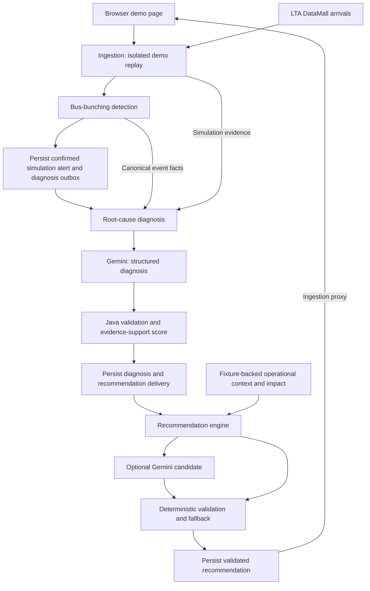

# Document Submission (2): Technical Details — OCC

Prepared on 6 October 2026 from the current repository working tree.

## Scope and evidence

OCC stands for **Semi-autonomous Operations Control Center**. The project README describes a broader vision for supporting Singapore public bus operations. The implemented slice examined here focuses on arrival ingestion, bus-bunching detection, simulation-based root-cause diagnosis, and mitigation recommendations.

This document answers the topics in the supplied submission slide. Implementation statements are grounded in repository code, configuration, migrations, tests, and documentation. Design explanations describe the implications of those choices; they do not assert undocumented team decisions. Existing uncommitted changes are included in this snapshot, so this is not a description of a confirmed released version.

**Evidence labels used below:**

- **Implemented:** supporting code or configuration exists. This alone does not establish deployment success.
- **Documented verification:** an existing repository document reports a previous check. That check was not repeated while preparing this file.
- **To answer later:** missing decisions, measurements, or evidence that must be supplied before making the corresponding claim.
- **Suggested improvement:** proposed follow-up work, not an implemented feature.

No application tests, live model calls, or deployment checks were run for this documentation task. No external provider availability was verified. In particular, a configured model name is not proof that the model is available in the intended deployment.

## 1. Software design and component architecture

### 1.1 Service responsibilities

The current implementation consists of four independently packaged Spring Boot services. Each has its own Maven build, Dockerfile, configuration, and database migrations.

| Component | Implemented responsibility | Boundary |
|---|---|---|
| Ingestion | Polls DataMall arrival data, maintains reference topology, stores raw and normalized observations, exposes read APIs, and manages isolated demo replays. | Owns the `ingestion` schema and the browser-facing demo page. |
| Bus-bunching detection | Consumes stored arrival snapshots, evaluates predicted-arrival headways, maintains alert episodes, and queues diagnosis work for confirmed simulation events. | Owns the `bunching` schema and canonical detection facts. |
| Root-cause diagnosis | Retrieves producer-owned facts and ingestion evidence, obtains a structured Gemini diagnosis, validates citations, computes an evidence-support score, and queues recommendation delivery. | Owns the `diagnosis` schema. The implemented actionable event type is simulation bus bunching. |
| Recommendation engine | Applies deterministic mitigation policy, optionally validates a Gemini candidate, and stores recommendations and model invocation audit records. | Owns the `recommendation` schema. Operational context and impact estimates currently come from a maintained fixture. |

The Maven configuration specifies Java 25 and Spring Boot 4.1.1. The AI services use Spring AI 2.0.1. Other implemented technologies include PostgreSQL, Flyway, Docker Compose, springdoc OpenAPI, Swagger UI, and Testcontainers. The local database image is `postgis/postgis:18-3.6`; this image choice alone does not demonstrate use of spatial database functions.

### 1.2 Internal component design

The repository defines three principal layers:

```text
api → domain ← infrastructure
```

Controllers receive HTTP requests, validate request DTOs, and delegate to domain services. Domain services and policies contain orchestration and decision rules. Infrastructure adapters integrate external APIs, model providers, scheduling, and persistence where appropriate. Domain ports define provider-neutral integration contracts. ArchUnit tests exist in all four services to check architectural dependencies.

This arrangement provides a clear boundary for replacing a provider adapter or changing an HTTP interface without moving provider-specific behavior into a business policy. Pure policies, such as `BunchingPolicy` and `BunchingRecommendationPolicy`, can be exercised independently of remote services. The implementation uses both JPA repositories and JDBC persistence adapters; it should not be described as using one uniform persistence mechanism everywhere.

### 1.3 Implemented simulation workflow



The demo emits a normal headway followed by two short-headway samples. Detection confirms simulation bunching using consecutive evidence, then stores the canonical alert and diagnosis outbox work transactionally. Diagnosis obtains the facts and contextual evidence through HTTP, validates the model result, and persists the diagnosis and downstream delivery payload before sending it. Retries reuse a stable idempotency key and persisted payload.

Live observations are classified `OBSERVATION_ONLY`; demo evidence is classified `SIMULATION` and scoped by `demo_run_id`. Live polling continues during a demo, while detection selects one feed scope at a time. Live detections do not enter the simulation recommendation workflow. The implemented recommendation path produces advisory output; it does not execute fleet instructions.

**Evidence:** [project README](../README.md), [engineering conventions](CONVENTIONS.md), [ingestion README](../services/ingestion/README.md), [detection README](../services/operations/bus-bunching-detection/README.md), [diagnosis README](../services/planning/root-cause-diagnosis/README.md), [recommendation README](../services/planning/recommendation-engine/README.md), and [Compose configuration](../infra/local/compose.yaml).

## 2. API route design and implementation

### 2.1 Route organization

Browser-facing routes use `/api/v1/...`; service integration routes use `/internal/v1/...`. Routes generally identify plural resources and use HTTP verbs for reads and mutations. The following table gives representative implemented routes rather than an exhaustive API inventory.

| Service | Method and route | Purpose |
|---|---|---|
| Ingestion | `GET /api/v1/arrivals` | Paginated current live arrivals. |
| Ingestion | `GET /api/v1/arrivals/history` | Arrival observation history. |
| Ingestion | `GET /api/v1/bus-routes/{serviceId}` | Route topology for a service. |
| Ingestion | `GET /api/v1/bus-stops/{stopCode}` | Stop details. |
| Ingestion | `POST /api/v1/demo-runs` | Start a demo replay. |
| Ingestion | `GET /api/v1/demo-runs/{id}` | Read replay state and alerts. |
| Ingestion | `POST /api/v1/demo-runs/{id}/close` | Close the demo and return detection to the live feed. |
| Ingestion | `GET /api/v1/demo-runs/{id}/recommendation` | Obtain the simulation recommendation for display. |
| Ingestion | `GET /internal/v1/arrival-snapshots` | Incrementally read normalized live snapshots. |
| Ingestion | `GET /internal/v1/demo-runs/{demoRunId}/root-cause-context` | Retrieve simulation evidence for diagnosis. |
| Detection | `PUT /internal/v1/consumer-selection` | Select live consumption or a particular demo run. |
| Detection | `GET /internal/v1/bunching-alert-events/{eventId}` | Retrieve authoritative detection facts. |
| Detection | `GET /api/v1/live-bunching-alerts` | Read currently open live observation alerts. |
| Diagnosis | `POST /internal/v1/diagnosis-requests` | Accept asynchronous diagnosis work; returns `202 Accepted`. |
| Diagnosis | `GET /internal/v1/diagnosis-requests/{requestId}` | Read processing status. |
| Diagnosis | `GET /internal/v1/diagnoses/{diagnosisId}` | Read diagnosis and recommendation-delivery status. |
| Recommendation | `POST /internal/v1/bunching-recommendations` | Produce or replay one durable recommendation. |
| Recommendation | `GET /internal/v1/bunching-recommendations/by-bunching-event/{bunchingEventId}` | Look up a recommendation by event. |

### 2.2 Validation, errors, and retry semantics

HTTP DTOs and Jakarta Validation enforce boundary constraints. Central exception handlers produce problem responses. The recommendation API documents `400` for invalid input, `409` for conflicting idempotency-key reuse, and `422` for valid requests that cannot produce an actionable recommendation. Invalid client requests must be corrected rather than retried unchanged.

Diagnosis and recommendation submission require UUID `Idempotency-Key` headers. Diagnosis also deduplicates the business event using `(eventType, producer, eventId, schemaVersion)`. Recommendation stores a validated request fingerprint and response so an identical retry can return the stored result. Database uniqueness constraints support these guarantees under concurrent requests.

Durable delivery work uses leases and retry scheduling. Transient delivery failures use exponential backoff with jitter and capped delay. Some delivery paths default to unlimited attempts; bounded backoff does not mean a finite number of retries. Terminal validation or conflict failures are recorded separately.

An `/internal/` prefix communicates intended usage but does not enforce access control. The current local Compose file publishes all four service ports.

### 2.3 API documentation

Each service has an OpenAPI JSON artifact and runtime-generated documentation. Swagger UI supports interactive exploration. The CI workflow validates stored contracts and checks changed contracts for breaking changes. This does not by itself prove that stored specifications exactly match the current runtime implementation; regeneration and comparison still require evidence.

**Evidence:** controllers under each service's `api/` directory; [ingestion contract](../services/ingestion/openapi/polling-ingestion.json), [detection contract](../services/operations/bus-bunching-detection/openapi/bus-bunching-detection.json), [diagnosis contract](../services/planning/root-cause-diagnosis/openapi/root-cause-diagnosis.json), and [recommendation contract](../services/planning/recommendation-engine/openapi/recommendation-engine.json).

## 3. AI integration

### 3.1 Models and model responsibilities

Both AI services configure `gemini-3.1-flash-lite` as the default model through environment-backed settings. Diagnosis uses Gemini for a structured contributing-cause assessment. Recommendation can use Gemini to propose a structured mitigation candidate, but `OCC_RECOMMENDATION_AI_ENABLED` defaults to `false`.

The recommendation README reports a historical live-provider check with a different model. It explicitly states that the current default still needs its own deployment smoke check. This submission therefore cannot claim that the current configured model has been successfully validated in the target environment.

There is no implemented model-directed tool use, vector store, conversational memory, or retrieval-augmented generation in the diagnosis flow. Java chooses and fetches evidence before calling the model. The implemented AI design is a controlled application workflow with structured model calls; the broader project description of an agentic system should not imply autonomous model control of services or buses.

### 3.2 Data pipeline and evidence provenance

Ingestion stores polling metadata, raw provider observations, normalized arrivals, and reference topology. Demo observations use the same processing concepts while remaining explicitly simulation-scoped. Detection groups arrivals by service, stop, and direction and evaluates predicted-arrival headway. It checks freshness and insufficient evidence rather than treating every snapshot as usable.

Diagnosis receives an event reference rather than trusting caller-supplied event facts. It retrieves canonical detector facts and typed context, checks simulation provenance and observation membership, bounds the evidence, and produces an evidence snapshot. The model receives supplied evidence IDs and must cite only those IDs. Java independently validates the returned citations and cause taxonomy.

The implemented diagnosis distinguishes `TRAFFIC_INCIDENT` from `UNKNOWN`. Temporal or spatial correlation is treated as evidence of a possible contributor, not proof of causation. The wider README vision mentions weather and rail disruptions, but this examination does not establish an implemented end-to-end diagnosis pipeline for those sources.

### 3.3 Prompt and orchestration design

The diagnosis system prompt instructs the model to preserve producer-owned facts, avoid invented evidence, treat input as untrusted data, and return the requested structured fields. The prompt version is `root-cause-bunching-v1`, and the output schema version is `root-cause-output-v1`. One validation-repair call is permitted after an invalid result. Provider failures follow a separate retry path; the repair bound should not be described as a lifetime limit of two provider calls per event.

The recommendation prompt version is `bunching-candidate-v1`, with output schema `mitigation-candidate-v1`. It asks for one candidate grounded in the event, diagnosis, and validated context. Deterministic preflight runs before optional generation. Java checks the action, bus, stop, and adjustment against the deterministic result; model output cannot override the selected operational action or impact estimate.

Supported recommendation actions are `HOLD` and `DWELL_ADJUSTMENT`. The policy limits the adjustment to the lowest applicable context limit, headway deficit, and 120-second absolute safety limit. Standby dispatch is not supported by this slice.

### 3.4 Guardrails and auditability

Implemented controls include structured output, evidence allow-lists, simulation classification checks, request/prompt size bounds, evidence cardinality limits, and deterministic recommendation validation. Unsafe, empty, mismatched, or failed recommendation candidates fall back to the deterministic recommendation. Diagnosis failure handling instead records a failure or schedules retry; it should not be described as having the same fallback as recommendation.

Diagnosis computes `bunching-evidence-support-v1` from provenance, temporal alignment, spatial alignment, incident specificity, and headway chronology. Its score is capped at `0.85`; `UNKNOWN` receives zero. This is an explainable support score, not a calibrated probability of causation. The default `0.70` review threshold adds a limitation; completed low-confidence diagnoses still proceed downstream. The threshold is not an implemented human approval gate.

Model audit records include provider/model identifiers, prompt/schema versions, timings, optional token usage, validation outcomes, and sanitized failure information. Persisted operational input and diagnosis evidence support inspection. The documented audit design excludes API keys, rendered prompts, raw provider responses/errors, and stack traces from those audit tables.

### 3.5 Evaluation status

Automated tests exist for model output validation, invalid citations, repair, provider failure, deterministic matching, and fallback behavior. These establish implementation behavior, not diagnosis accuracy or operational benefit. No maintained labelled benchmark, calibrated confidence study, or measured fleet outcome was established during this review.

**To answer later:** evaluation cases, ground-truth labels and reviewers, diagnosis accuracy, unsupported-claim rate, citation validity, candidate acceptance/fallback rates, latency percentiles, token cost per event, and performance across model/prompt versions.

**Evidence:** [diagnosis model adapter](../services/planning/root-cause-diagnosis/src/main/java/com/csd/occ/diagnosis/infrastructure/gemini/GeminiRootCauseModelAdapter.java), [diagnosis processor](../services/planning/root-cause-diagnosis/src/main/java/com/csd/occ/diagnosis/domain/RootCauseDiagnosisProcessor.java), [recommendation model adapter](../services/planning/recommendation-engine/src/main/java/com/csd/occ/planning/recommendationengine/infrastructure/gemini/GeminiMitigationCandidateAdapter.java), [recommendation policy](../services/planning/recommendation-engine/src/main/java/com/csd/occ/planning/recommendationengine/domain/BunchingRecommendationPolicy.java), and [configuration inventory](../.env.example).

## 4. User interface design

The implemented UI is an HTML/CSS/JavaScript demo page served by ingestion at `/demo.html`. It starts a simulation, displays replay status and bunching alerts, shows a simulation recommendation, and returns the detector to live consumption. Separate tables display live arrivals and live observation alerts. Live detection display is hidden while simulation is active.

The recommendation view presents the action, adjustment duration, target bus, control stop, diagnosis, confidence, rationale, trade-offs, limitations, and fixture-backed expected impact. Simulation labels distinguish fictional evidence from live observations. Browser requests use ingestion's same-origin APIs, including proxy endpoints for downstream results.

The page polls demo status and recommendations at one-second intervals and live views at five-second intervals. It provides loading/error messages, disabled controls during operations, an `aria-live` status element, and escaped values when rendering dynamic HTML. These code features do not establish a completed accessibility assessment or usability study.

**Suggested improvement:** show the evidence-support score with wording that explains its meaning, make diagnosis/delivery failures and stale results explicit, and externalize the browser polling intervals and local URL currently embedded in the page in line with the repository configuration policy. Validate keyboard use, narrow-screen layouts, and comprehension with representative users before claiming usability.

**To answer later:** intended users, task scenarios, wireframes or screenshots, usability feedback, and whether a complete controller/driver interface is required beyond this demonstration.

**Evidence:** [demo page source](../services/ingestion/src/main/resources/demo.html) and [demo API controller](../services/ingestion/src/main/java/com/csd/occ/ingestion/api/DemoRunController.java).

## 5. Database design

### 5.1 Ownership and storage

The local stack shares one PostgreSQL instance while separating service-owned schemas and roles. This provides logical ownership but retains a shared database infrastructure dependency.

| Schema | Role | Principal stored information |
|---|---|---|
| `ingestion` | `occ_ingestion` | Polling/raw observations, reference topology, normalized arrivals, feed status, demo runs and assignments, simulation incidents. |
| `bunching` | `occ_bunching` | Evaluations, live/demo alert state, immutable alert events, feed cursors, retry/rejection/audit state, diagnosis outbox. |
| `diagnosis` | `occ_diagnosis` | Diagnosis requests, completed diagnoses, evidence snapshots/hashes, model invocation records, recommendation delivery. |
| `recommendation` | `occ_recommendation` | Durable recommendations, request fingerprints/context/output, model invocation audit records. |

Flyway versioned SQL manages schema evolution. Relationships and constraints enforce local consistency: demo assignments belong to a run, diagnosis records reference requests, recommendation deliveries reference diagnoses, and model audits reference their parent records. Unique constraints protect idempotency and event deduplication. Queue claim indexes support due-work selection. Timestamp columns use `TIMESTAMPTZ` for moments in time.

The simulation classification and run scope are recorded with relevant observations and enforced through database constraints and filtered queries. Live arrival views exclude simulation records. Retention logic exists for live ingestion observations; a complete retention policy for all audit, simulation, and diagnosis data still needs to be specified.

### 5.2 Cross-service access

Diagnosis retrieves peer data through APIs rather than direct database queries. The database provisioning scripts also grant the bunching role read access to specific ingestion views. Therefore, this is not an entirely database-independent microservice design. Restricted read contracts reduce exposure compared with broad table access, but those grants and views remain a coupling point that needs explicit ownership.

**To answer later:** a final ER diagram, expected data volume and growth, query performance measurements, complete retention/deletion policy, backup schedule, restore evidence, and recovery objectives. Existing migration and role scripts do not establish a tested disaster-recovery process.

**Evidence:** migration directories under each service's `src/main/resources/db/migration/`, [database provisioning scripts](../infra/local/postgres/init/), and [bunching read grants](../infra/local/postgres/init/03_bunching_read_grants.sh).

## 6. Security design

Implemented security-relevant measures include environment-supplied credentials, a central non-secret configuration inventory, service-specific database roles, restricted ingestion view grants, input validation, selected payload limits, simulation-only planning, sanitized model audit metadata, and non-root users in service container images.

However, application-level authentication and authorization are not implemented in the examined services. No Spring Security dependency or security filter chain was found. Local Compose exposes service ports, including internal APIs. A route prefix or simulation classification is not a substitute for caller authentication. Unauthenticated runtime mutations and AI-triggering requests therefore remain a material deployment gap.

**Suggested improvement:** establish the user/service identity model and enforce permissions for mutations, diagnosis requests, recommendation access, and administrative endpoints. Specify how internal APIs are isolated and how transport protection, credential rotation, and abuse limits operate in the target environment. These are proposed controls, not current capabilities.

**To answer later:** identity provider, user roles, service credentials, permission matrix, TLS/network boundary, audit access policy, secret store, rotation process, rate limits, and handling of sensitive operational data sent to the model provider. Deployment protection was not verified during this task.

**Evidence:** [service build files](../services/), [container and network configuration](../infra/local/compose.yaml), [.env.example](../.env.example), [database provisioning](../infra/local/postgres/init/), and the current-status section of the [production-readiness review](production-readiness-review.md).

## 7. Testing

The repository contains multiple testing layers:

| Layer | Examples of existing coverage | What it establishes |
|---|---|---|
| Unit/domain | Bunching policy, replay scenarios, recommendation safety, idempotency orchestration, evidence bounds, retry backoff, and diagnosis processing. | Isolated rule and orchestration behavior for tested cases. |
| API slices | Arrival/demo routes, consumer selection, diagnosis requests, recommendation validation/errors, and request body limits. | Controller contracts and boundary behavior. |
| Adapter tests | DataMall handling, stored-arrival HTTP integration, fixture loading, and Gemini candidate handling. | Integration behavior using controlled collaborators. |
| PostgreSQL integration | Ingestion startup/wiring, alert recording, diagnosis outbox delivery, diagnosis uniqueness/leases/transactions, and recommendation persistence. | Tested database behavior using Testcontainers. |
| Architecture | ArchUnit tests in all four services. | Selected dependency and layering constraints. |
| Coverage gates | JaCoCo gates in ingestion and detection for selected paths. | Coverage thresholds for those configured paths, not universal coverage. |

The existing production-readiness document reports the following verification results. They are included as **documented verification**, not fresh results from this task:

| Service | Reported unit tests | Reported PostgreSQL integration tests | Reported result |
|---|---:|---:|---|
| Ingestion | 53 | 4 | Passed. |
| Detection | 52 | 22 | Passed. |
| Recommendation | 52 | 12 | Passed. |
| Diagnosis | 14 | 7 | Passed. |

Maven `verify` is the maintained build/test entry point. The CI workflow additionally requires a nonzero Failsafe integration-test count. Recommendation tests do not require live Gemini calls. Tests with controlled providers should be distinguished from a live-provider compatibility check.

**Suggested improvement:** add a reproducible full-stack test from demo start through diagnosis and recommendation display, including downstream outages, retries, restart recovery, and repeated requests. Add provider/consumer contract verification and a separate AI evaluation dataset. Capture dated test artifacts for the submitted revision rather than relying only on narrative results.

**To answer later:** submitted commit/revision, latest test logs, scope of skipped tests, coverage reports, full-stack results, load/concurrency results, AI benchmark results, and browser/accessibility checks.

**Evidence:** each service's `src/test/` and `pom.xml`, [CI workflow](../.github/workflows/ci.yml), and [documented verification](production-readiness-review.md).

## 8. Continuous integration and deployment strategy

### 8.1 Implemented CI configuration

The GitHub Actions workflow runs on pushes, pull requests, and manual dispatch. It defines per-service Java 25/Maven verification, requires executed integration tests, checks the recommendation Maven wrapper on Windows, validates stored OpenAPI documents, checks contract compatibility, builds container images, and scans them with Trivy. The scan is configured to fail for fixable high/critical vulnerabilities. Action references are pinned to commit hashes.

This is evidence of configured gates. The workflow is currently part of the working tree, and successful hosted CI execution was not verified here. It should not be described as a proven release pipeline without run artifacts.

### 8.2 Implemented local deployment

Dockerfiles use build and runtime stages, package executable service JARs, and run service processes as a non-root user. The local Compose stack provisions PostgreSQL schemas/roles, starts services with dependencies, persists database data in a volume, and checks readiness endpoints. Database readiness contributes to readiness while liveness tracks process state.

| Service | Default host/public port | Default container-internal port |
|---|---:|---:|
| Ingestion | 6767 | 8001 |
| Detection | 6768 | 8002 |
| Recommendation | 6769 | 8003 |
| Diagnosis | 6770 | 8004 |

PostgreSQL uses host port 5432 and pgAdmin uses 6700. Settings are externalized through environment variables and typed service configuration. Host-facing URLs and Compose-only internal URLs are separately named; containers use service DNS and internal ports. The ignored local `.env` is documented by the repository-root `.env.example`.

The existing workflow does not define an automatic deployment job, production environment, release promotion, or rollback procedure. Local Compose is the implemented deployment mechanism examined here.

**To answer later:** target hosting environment, image registry and versioning, deployment trigger/approval policy, secret injection, migration compatibility, rollback steps, health-based rollout criteria, and backup/restore responsibilities.

**Evidence:** [CI workflow](../.github/workflows/ci.yml), [Compose configuration](../infra/local/compose.yaml), [local deployment README](../infra/local/README.md), service Dockerfiles, and [.env.example](../.env.example).

## 9. Other relevant technical details

**Resilience and consistency:** transactional outboxes and persisted delivery payloads reduce lost handoffs; idempotency reduces duplicate persisted results. Queue workers use row locks and leases. External HTTP/model calls occur outside claim transactions. These mechanisms do not justify claiming exactly-once external execution. The recommendation README notes that concurrent first requests sharing a key can both invoke the provider before only one recommendation wins persistence.

**Observability:** Actuator probes, status APIs, and model audit records exist. The production-readiness review identifies metrics, distributed tracing, correlated logging, and alerting as follow-up work. Service-level objectives and measured system capacity are not established by this snapshot.

**Operational interpretation:** DataMall predictions support headway observation, not necessarily a complete vehicle tracking or control model. Demo identities are fictional. Fixture-backed impact estimates are simulation inputs, not measured improvements in passenger waiting time or real fleet performance.

**Documentation accuracy:** older documents describe simulation incidents as not yet consumed by diagnosis, and the recommendation README retains statements that diagnosis-to-recommendation integration is future work. Current diagnosis code implements those handoffs. The conventions document also suggests adding ArchUnit later although architecture tests now exist. Reconcile these statements before submission so readers receive one consistent account of current scope.

## 10. Questions to answer later — do not fill these with assumptions

These are the missing details to collect from the team or establish through checks. None should be presented as completed work until supported.

| Area | Question to answer | Evidence to attach |
|---|---|---|
| Submission scope | Which revision is submitted, and which wider OCC features are included? | Commit hash and explicit in/out-of-scope list. |
| Architecture decisions | Why were four services and a shared PostgreSQL instance chosen? | Team rationale covering complexity, ownership, and trade-offs. |
| Model compatibility | Does the current configured model work with the target account and deployment? | Sanitized dated smoke-check result and configuration version. |
| AI evaluation | How accurate and grounded are diagnoses across representative cases? | Labelled cases, review rubric, measured results, and failure examples. |
| Confidence | How should a controller interpret the evidence-support score? | UI wording, review process, and any calibration evidence. |
| Operational context | When will fixtures be replaced by validated operational inputs? | Source ownership and API contract for safety/context facts. |
| Impact | How are intervention benefits estimated and validated? | Simulation method and comparative results, or clearly labelled fixture assumptions. |
| UI | Who uses the interface, and does it support their actual tasks? | User/task description, screenshots, and usability feedback. |
| Identity and access | Who can read, mutate, administer, and invoke AI work? | Identity choice, role/service permission matrix, and enforcement tests. |
| Data governance | What data is sensitive, retained, deleted, or sent to providers? | Data inventory, retention schedule, access policy, and provider-data decision. |
| Recovery | Can the system recover from service restarts and database loss? | Restart/outage checks, backup/restore exercise, and recovery objectives. |
| Testing | Does the submitted revision pass all required checks? | Fresh logs, coverage artifacts, full-stack and contract results. |
| Production deployment | Where and how is the application released and rolled back? | Deployment configuration, CI run links, release procedure, and rollback evidence. |
| Operations | What performance and reliability targets apply? | Workload assumptions, latency/throughput measurements, SLOs, dashboards, and alert rules. |

## 11. What needs improvement

### Priority 1 — resolve before claiming production readiness

1. **Enforce authentication and authorization.** Publicly reachable mutation and internal AI endpoints currently lack application access control. Define identities and permissions, then verify enforcement.
2. **Validate the current model and complete workflow.** Check the current configured model separately from historical runs, and demonstrate the full simulation path with failure/recovery cases.
3. **Keep operational claims within the evidence.** Clearly label fixture-backed safety context and impact. Supply validated operational integrations before claiming live mitigation capability or measured benefits.
4. **Establish AI quality measurements.** Separate schema/citation correctness from causal usefulness. Use labelled cases and record unsupported claims, uncertainty, cost, and latency.

### Priority 2 — strengthen the submission and integration evidence

5. **Synchronize documentation and contracts.** Correct stale integration/ArchUnit statements and verify runtime OpenAPI against the submitted revision.
6. **Add full-stack and consumer/provider verification.** Existing component tests leave cross-service and UI wiring less directly evidenced.
7. **Make UI limitations understandable.** Explain the support score, simulation scope, fixture estimates, and stalled or failed workflow states. Verify accessibility and remove hard-coded deployment settings from browser code.
8. **Document data ownership and lifecycle.** Add an ER diagram, describe read-view coupling, and define retention for simulations, diagnosis snapshots, audit records, and delivery failures.

### Priority 3 — prepare for sustained operation

9. **Define deployment and recovery procedures.** Establish release promotion, migration safety, rollback, backups, and restore verification for the chosen environment.
10. **Add operational visibility and workload evidence.** Define correlated logs, metrics, traces, alerts, retry/dead-letter handling, and performance targets. Measure against the intended workload before claiming scalability.

The current evidence supports describing OCC as a service-based prototype with a controlled simulation diagnosis/recommendation workflow, deterministic safeguards, durable handoffs, database ownership boundaries, component tests, and configured CI gates. Broader autonomous dispatch, production security, measured AI quality, and real operational benefits remain claims to substantiate separately.
